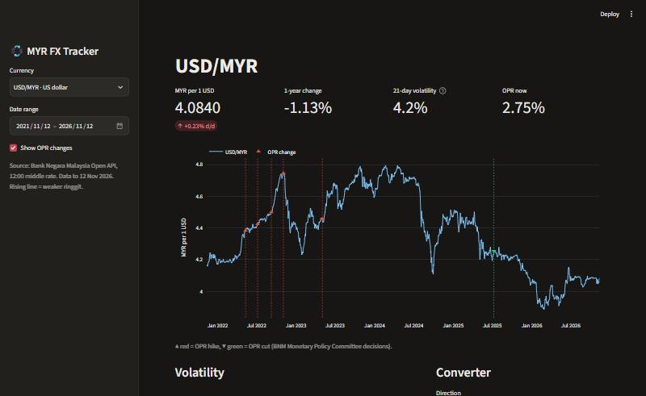
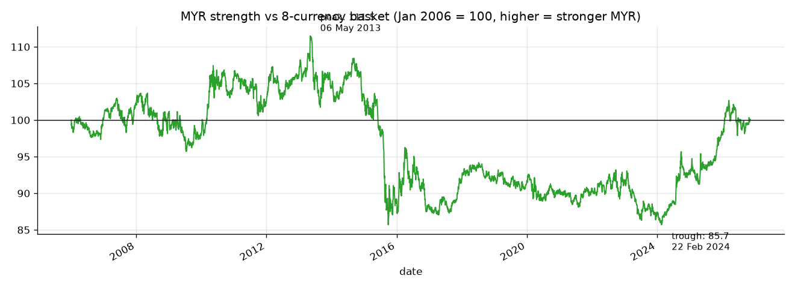
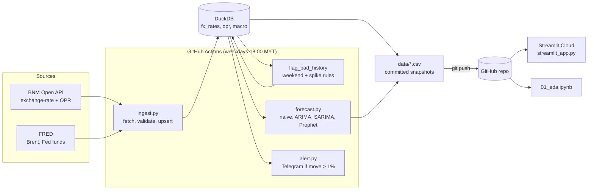

# MYR FX Forecast

**An automated ringgit exchange-rate pipeline and dashboard: 20 years of Bank Negara Malaysia rates, analysis of what moves MYR, and an honest 30-day forecast test.**



**Live demo:** _coming soon (Streamlit Community Cloud)_ · **Notebook:** [`notebooks/01_eda.ipynb`](notebooks/01_eda.ipynb) · **Backtest:** [`reports/backtest_summary.md`](reports/backtest_summary.md)

## Problem
Malaysian students paying overseas fees, and SMEs paying suppliers, ask the same questions.
Is the ringgit weak right now? What moves it? Should I convert today or wait?
Bank and news sites show today's rate but not context, risk or evidence. This project
builds a self-updating data pipeline from the official source and answers those three questions with data.

## Data
| Source | What | Notes |
|---|---|---|
| [BNM Open API](https://apikijangportal.bnm.gov.my/) `/exchange-rate` | USD, SGD, CNY, EUR, GBP, JPY, THB, IDR vs MYR, daily, **Jan 2006 to today** (41k rows) | 12:00 **noon session**. The default 11:30 session lacks IDR and THB and only goes back to 2021, while noon covers every currency from 2006 and includes a middle rate. JPY, THB and IDR are quoted per 100 units. |
| BNM Open API `/opr` | All 140 Monetary Policy Committee decisions since 2004 | 24 actual changes (14 hikes, 10 cuts) |
| [FRED](https://fred.stlouisfed.org/) | Brent crude (`DCOILBRENTEU`), US effective Fed funds (`DFF`) | Context for the "drivers" analysis only. Best-effort: a FRED outage never blocks the BNM update. |

**Data quality.** BNM's own history has errors, which the pipeline removes with logged rules
(`src/myr_fx/validate.py`). These include about 40 weekend rows that repeat Friday's quote, and bad prints on 1 and 2 Jan 2007
(the EUR/GBP rows contain *cross rates*, and JPY is scaled 100x too small).
No backfill from other sources was needed.

## Key findings
1. **MYR's big moves are episodic, not a slow drift.** The 2014–16 oil collapse and 1MDB scandal added 36% to USD/MYR in 18 months.
   The 2022–24 Fed hiking cycle added another 15%, to a record 4.79 on 17 Apr 2024, before a 14% rebound in 2024.
   Against an equal-weight 8-currency basket, MYR peaked the day after GE13 (6 May 2013) and bottomed on 22 Feb 2024.
2. **What drives it: the US–Malaysia rate gap explains the *level* (ρ = 0.49). Oil helps a little month to month.**
   A 10% Brent rise goes with about 0.2% MYR strengthening (t ≈ −2.2). Together the two explain only about 2% of monthly moves.
   The rest is global dollar sentiment and politics.
3. **OPR decisions have no detectable effect on USD/MYR.** The 20-day move after a decision is about 0.1%, against 1.8% noise on random days.
   BNM's 25 bp steps are anticipated by markets.
4. **USD and CNY move almost as one against MYR (ρ = 0.88)**, so splitting a payment across them doesn't diversify.
   SGD/MYR is the calmest pair (3.4% annual volatility vs 5.0% for USD).
5. **Nothing beats "tomorrow = today" for a 30-day forecast.** This is the classic Meese–Rogoff result for FX.



## How good is the forecast, really?
Walk-forward backtest: 24 non-overlapping monthly folds ending at today. Each model is refit on the
3 years before each fold and predicts 21 business days ahead (≈30 calendar days).

| USD/MYR | MAE (MYR) | MAPE | MAPE at day 21 | 95% band coverage | vs naive | paired t |
|---|---|---|---|---|---|---|
| **naive (random walk)** | **0.0351** | **0.84%** | 1.21% | 96% | 1.00 | — |
| ARIMA (auto, AIC) | 0.0355 | 0.85% | 1.26% | 98% | 1.01 | 0.35 |
| SARIMA (1,1,1)(1,0,1,5) | 0.0355 | 0.85% | 1.21% | 97% | 1.01 | 0.44 |
| Prophet | 0.0765 | 1.81% | 2.44% | **59%** | 2.18 | 4.07 |

SGD/MYR shows the same pattern: ARIMA 0.997x naive (t = −0.09, i.e. noise), Prophet 1.63x worse ([full table](reports/backtest_summary.md)).

**Why the naive baseline wins.** FX is one of the most liquid markets in the world. Any
predictable pattern in past prices gets traded away, so the best guess for next month is about
today's rate. Auto-ARIMA mostly selects a near-random-walk on its own. The weekly seasonal term
adds nothing. Prophet does worst because it fits trend and yearly seasonality that FX doesn't
have, and its 95% band only covers 59% of outcomes: it is overconfident.
**The useful output is the band, not the line.** A typical ±1.2% error over 30 days (about ±RM0.05 per USD)
is the buffer a student should budget for.

## Features
- **Pipeline:** idempotent ingest (fetch → validate → upsert on `(date, currency)` → CSV snapshot). Daily GitHub Actions cron on Malaysian business days (KL public holidays skipped).
- **Dashboard:** pair selector, date range, price chart with OPR hike and cut markers, rolling volatility, 30-day forecast with 95% band and the backtest table, MYR converter with BNM buy/sell rates.
- **"Best day to convert" helper:** no prediction (see above). It shows where today's rate sits in its 90-day range and suggests splitting large payments when the rate is mid-range or expensive.
- **Optional Telegram alert** when USD/MYR moves more than 1% between fixes (set `TELEGRAM_BOT_TOKEN` and `TELEGRAM_CHAT_ID` as repo secrets).

## Architecture

**Why CSV snapshots in git instead of committing the `.duckdb` file?** A binary database
rewritten daily would bloat git history with unreadable diffs. Sorted CSVs give small
append-only diffs (one line per currency per day), and DuckDB rebuilds from them in under a second.

## Stack
Python 3.12 · uv · DuckDB · pandas · statsmodels / pmdarima / Prophet · Streamlit + Plotly · matplotlib · pytest · ruff · GitHub Actions

## Run it
```bash
uv sync
uv run python -m myr_fx.ingest            # incremental update (data already committed)
uv run python -m myr_fx.forecast          # backtest (~5 min) + forecasts
uv run streamlit run app/streamlit_app.py
uv run pytest
```
Full refetch from 2006: `uv run python -m myr_fx.ingest --full` (about 1,700 API calls, about 16 min).

## Project layout
```
src/myr_fx/   sources.py (BNM + FRED clients) · validate.py · db.py · ingest.py · bizdays.py
              insights.py (volatility, strength index, event study) · forecast.py · alert.py
app/          streamlit_app.py + slim requirements.txt for Streamlit Cloud
notebooks/    01_eda.ipynb
reports/      backtest results (per-fold CSVs + summary)
data/         fx_rates.csv · opr.csv · macro.csv · forecast.csv
```

## Limitations
- **Noon fix only.** One observation a day misses intraday moves, and its timing understates EUR and GBP correlations (Europe hasn't opened yet).
- **IDR is coarse.** BNM quotes it to 4 decimals per 100 IDR, so it moves in about 0.4% steps.
- **Drivers analysis is correlational.** Oil, US rates and the dollar share the global cycle. No causal identification.
- **Small event sample.** 24 OPR changes makes the event study low-powered: "no detectable effect", not "no effect".
- **Backtest covers about 2 years** (24 folds). A different regime (for example 2015) could rank the models differently, though the naive-wins result is robust across the FX literature.
- **Converter uses the interbank mid rate.** Real bank and remittance rates include a margin of 0.5–3%.
